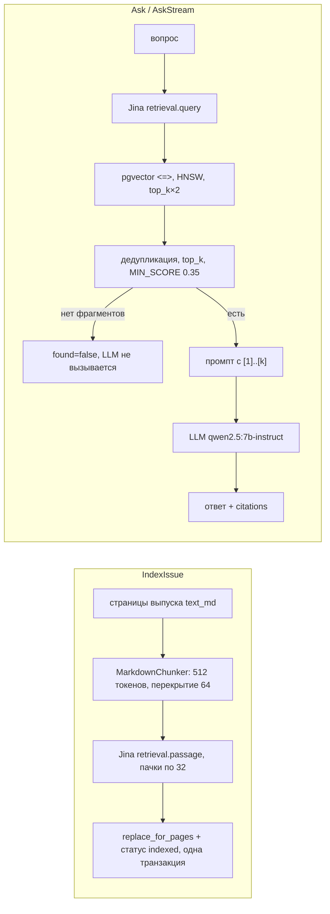

# ЛР3 — ответы на вопросы преподавателя (дополнительно к разделу 3 `defense/lr3.md`)

Вопросы, которые задавали на защите ЛР3. По каждому — **Сказать** (своими словами, на примере CO-RAG) и **Показать** (файл → функция или команда).
Выводы и логи — из прогонов 2026-11-06: RAG и API запущены, выпуски сида проиндексированы (`bash scripts/demo_lr3.sh`, 15 с).
Окна и запуск — раздел 1 `defense/lr3.md`.

| № | Вопрос | Главное, что показать |
| --- | --- | --- |
| 1 | Использовали ИИ-технологии? | `CLAUDE.md`, `plans/lr3.md`, `git log` |
| 2 | Протокол gRPC | `rag.proto`, байты `08 0c`, `grpcurl list` |
| 3 | Как работает алгоритм | `RagServicer.Ask`, `Retriever.search`, `Indexer._index`, логи |
| 4 | Команда генерации из `.proto` | `scripts/gen_proto.sh` |
| 5 | Удалённый репозиторий | `git remote -v`, GitHub, PR #3 |
| 6 | Где вызывается gRPC-сервер | `server.py` → `serve`; `RagService.ask` → `RagClient.ask` |
| 7 | Как работает всё | два терминала + `demo_lr3.sh` |
| 8 | gRPC-сервер | `services/rag/src/corag_rag/server.py` → `serve` |
| 9 | Клиент | `packages/corag-contracts/src/corag_contracts/rag_client.py` → `RagClient` |
| 10 | Запуск сервера | `uv run --package corag-rag python -m corag_rag.server` |
| 11 | Асинхронность сервера через Postman | две вкладки gRPC: холодный `Ask` + `Search` |
| 12 | Какие ещё бывают серверы | таблица |
| 13 | Потоки и путь вопроса по коду — зачем | `JinaEmbedder._embed`, таблица слоёв |
| 14 | Unary и server streaming | `Ask` и `AskStream` |
| 15 | Плюсы и минусы gRPC | таблица |
| 16 | Почему дата в `.proto` строкой | `Timestamp`, `google.type.Date` |
| 17 | Написать streaming | `AskStream`: proto, сервер, клиент |
| 18 | Ограничения передачи и типы данных | лимит 4 МиБ, типы Protobuf |
| 19 | Зачем замыкание | `require_role`, `_handler`, `rpc` |

---

## 1. Вы использовали ИИ-технологии?

**Сказать** (черновик — отвечай честно и своими словами, допиши то, что знаешь только ты):
Да. Я работал с Claude Code — ИИ-ассистентом для программирования от Anthropic. Я этого не скрываю, следы есть в репозитории:

- `CLAUDE.md` — правила проекта для ассистента: архитектура из ТЗ, соглашения по коду, политика GPU;
- `plans/lrN.md` — планы лаб;
- в коммитах ЛР3 — строка `Co-Authored-By: Claude`.

Ассистент писал код, тесты и черновики документов по плану. Решения по ЛР3 принимал я, например:

- ветку ЛР3 создать от ЛР2;
- LLM выбрать сравнением трёх моделей на месте;
- добавить в `Citation` поля `issue_id` и `authors`;
- сделать `AskStream` потоком.

`[допиши: что делал сам — ТЗ, проверка, запуски, правки, разбор кода]`. Код я разобрал и могу объяснить любую его часть.

**Показать:** `CLAUDE.md`, `plans/lr3.md`, `git log --format='%h %s%n%b' -3`.

## 2. Протокол gRPC

**Сказать.**

- gRPC — RPC-фреймворк поверх HTTP/2: клиент вызывает метод удалённого сервиса как обычную функцию.
- Контракт описан в `.proto`. Из него `protoc` генерирует классы сообщений, клиентский stub и базовый класс сервера (servicer).
- Один вызов — один поток (stream) HTTP/2. Все вызовы мультиплексируются в одном TCP-соединении.
- Запрос состоит из двух частей:
  - HEADERS: `:method POST`, `:path /corag.rag.v1.RagService/Ask`, `content-type: application/grpc`, `grpc-timeout` (deadline);
  - DATA: сообщение Protobuf с префиксом в 5 байт (1 байт — флаг сжатия, 4 байта — длина).
- Ответ состоит из HEADERS, DATA и **trailers** с `grpc-status` и `grpc-message`. Статус приходит в конце, потому что ошибка может случиться уже после того, как часть данных ушла (стриминг).
- Встроены deadline, отмена вызова, метаданные и 17 стандартных статусов. У нас это `INVALID_ARGUMENT`, `NOT_FOUND`, `FAILED_PRECONDITION`, `UNAVAILABLE`, `DEADLINE_EXCEEDED` и `INTERNAL`.

**Показать:** `proto/rag/v1/rag.proto`. В байты попадают номер поля и тип, а не имя:

```text
IndexIssueRequest(issue_id=12)      → 08 0c                      # поле 1, varint, 12
AskStreamResponse(delta="Топ")      → 12 06 d0 a2 d0 be d0 bf    # поле 2, длина 6, UTF-8
```

```bash
grpcurl -plaintext localhost:50051 list
```

```text
corag.rag.v1.RagService
grpc.health.v1.Health
grpc.reflection.v1alpha.ServerReflection
```

## 3. Покажите и расскажите, как работает алгоритм

**Сказать.** Это наивный RAG, у него две фазы.



1. **Индексация** (`services/rag/src/corag_rag/indexer.py` → `Indexer._index`):
   - страница режется на чанки, формулы и таблицы не разрываются;
   - чанки векторизуются вне транзакции;
   - в одной транзакции старые чанки заменяются новыми. Поэтому повтор не плодит дубли.
2. **Ответ** (`services/rag/src/corag_rag/retriever.py` → `Retriever.search`):
   - эмбеддинг вопроса и косинусное сходство в pgvector;
   - отсев по порогу `MIN_SCORE`;
   - LLM получает пронумерованные фрагменты и отвечает со ссылками [n]. `citations` идут в том же порядке.

**Показать:** терминал 1 во время `demo_lr3.sh`:

```text
[rag] ← IndexIssue issue=3
[rag] IndexIssue issue=3: эмбеддинги 1/1 (6 чанков, 2.0 s)
[rag] IndexIssue issue=3: 6 pages → 6 chunks (2.0 s)
[rag] ← Ask "Как рассчитать ДОЭ для фокусировки в кольцо?" top_k=5
[rag] retrieved 3 chunks (best 0.77)
[rag] → LLM qwen2.5:7b-instruct: 3 фрагментов в контексте
[rag] ← LLM qwen2.5:7b-instruct 4.7 s, токены: промпт 595, ответ 82
[rag] → AskResponse 3 citations
[rag] нет фрагментов со сходством ≥ MIN_SCORE=0.35 (best 0.08) → found=false, LLM не вызывается
```

## 4. Какая команда генерирует файлы из `.proto`?

**Сказать.** Генерацию запускает `bash scripts/gen_proto.sh`. Внутри — `protoc` из пакета `grpcio-tools`:

```bash
uv run --no-sync python -m grpc_tools.protoc -I proto \
    --python_out=$OUT --pyi_out=$OUT --grpc_python_out=$OUT proto/rag/v1/rag.proto
```

Получаются три файла:

- `rag_pb2.py` — классы сообщений;
- `rag_pb2.pyi` — типы для IDE;
- `rag_pb2_grpc.py` — `RagServiceStub` (клиент), `RagServiceServicer` (сервер) и `add_RagServiceServicer_to_server`.

`protoc` пишет абсолютный импорт `from rag.v1 import rag_pb2`. Скрипт исправляет его `sed`-ом на `corag_contracts.rag.v1`. Руками сгенерированный код не правим.

**Показать:**

```bash
bash scripts/gen_proto.sh && git status --short    # пусто — генерация воспроизводима
```

```text
сгенерировано в packages/corag-contracts/src/corag_contracts/rag/v1: rag_pb2.py rag_pb2.pyi rag_pb2_grpc.py
```

В `rag_pb2_grpc.py` видно, что stub — это набор методов канала по пути `/пакет.Сервис/Метод`:

```python
self.AskStream = channel.unary_stream(
        '/corag.rag.v1.RagService/AskStream',
        ...
        response_deserializer=rag_dot_v1_dot_rag__pb2.AskStreamResponse.FromString,
```

## 5. Покажите удалённый репозиторий

**Показать:** <https://github.com/AStrateg2509/rag_optics>. Ветки и PR показать в браузере или в терминале:

```bash
git remote -v && git branch -r && gh pr list --state all
```

```text
origin	https://github.com/AStrateg2509/rag_optics.git (fetch)
origin	https://github.com/AStrateg2509/rag_optics.git (push)
  origin/lr1-db
  origin/lr2-rest-api
  origin/lr3-grpc-rag
  origin/main
3	ЛР3: gRPC RAG Service (Jina, pgvector, Ollama)	lr3-grpc-rag	OPEN
2	ЛР2: REST API (FastAPI, JWT, Nginx)	lr2-rest-api	OPEN
1	ЛР1: БД и слой доступа к данным (PostgreSQL + pgvector, SQLAlchemy async, Alembic)	lr1-db	MERGED
```

Одна лаба — одна ветка и один PR в `main`. Ветка ЛР3 создана от ЛР2, поэтому PR #3 сливается после #2.

## 6. Покажите, где вызывается gRPC-сервер

**Сказать.** Здесь две стороны — где сервер запускается и откуда его вызывают.

- **Запуск:** `services/rag/src/corag_rag/server.py`:
  - `main` → `asyncio.run(serve(settings))`;
  - в `serve` — `grpc.aio.server()`, `add_RagServiceServicer_to_server(servicer, server)`, `add_insecure_port("[::]:50051")`, `await server.start()`.
- **Вызов из API** при `POST /rag/ask`:

| Шаг | Файл → функция |
| --- | --- |
| HTTP-запрос, роль, валидация | `services/api/src/corag_api/routers/rag.py` → `ask` |
| Логи `[api] → gRPC`, ошибки → HTTP | `services/api/src/corag_api/services/rag_service.py` → `RagService.ask`, `_call` |
| Сам gRPC-вызов | `packages/corag-contracts/src/corag_contracts/rag_client.py` → `RagClient.ask` → `self._stub.Ask(request, timeout=…)` |
| Канал один на процесс | `services/api/src/corag_api/main.py` → `lifespan` (`app.state.rag_client`), `deps.py` → `get_rag_client` |
| Обработка на сервере | `services/rag/src/corag_rag/servicer.py` → `RagServicer.Ask` |

Логи API, реальные:

```text
[api] → gRPC Ask question="Как приготовить борщ?" top_k=по умолчанию
[api] ← gRPC Ask 1.2 s, found=false, 0 citations
```

## 7. Покажите, как работает всё

**Показать** по сценарию (раздел 1 `defense/lr3.md`):

1. Терминал 1 — RAG Service, терминал 2 — API.
2. Терминал 3 — `bash scripts/demo_lr3.sh`, 15 с:
   - вход;
   - 403 для researcher;
   - переиндексация трёх выпусков и её повтор;
   - 404 и 409;
   - `/rag/search`;
   - `/rag/ask` по архиву, с фильтром по годам и вне архива;
   - 422.
3. В терминалах 1–2 логи показывают путь `[api] → gRPC Ask` → `[rag] ← Ask` → `retrieved` → `→ LLM` → `← LLM` → `[api] ← gRPC Ask`.
4. Поток: `uv run --package corag-api python scripts/ask_stream.py "…"` (вопрос 17).
5. Ctrl+C в терминале 1 → `bash scripts/demo_lr3.sh --expect-down` → 503. После перезапуска снова 200.

## 8. Покажите gRPC-сервер и объясните

**Показать:** `services/rag/src/corag_rag/server.py` → `serve`. Листинг сокращён, номера шагов в комментариях добавлены для рассказа:

```python
async def serve(settings: RagSettings) -> None:
    async with get_session() as session:
        await ping(session)                                       # 1. БД доступна
    embedder = await asyncio.to_thread(JinaEmbedder.load, settings)  # 2. модель до открытия порта
    await asyncio.to_thread(embedder.warmup)
    ...
    servicer = RagServicer(retriever=..., indexer=..., llm=llm, settings=settings)
    server = grpc.aio.server()                                    # 3. асинхронный сервер
    rag_pb2_grpc.add_RagServiceServicer_to_server(servicer, server)
    health_servicer = health.aio.HealthServicer()                 # 4. grpc.health.v1
    health_pb2_grpc.add_HealthServicer_to_server(health_servicer, server)
    reflection.enable_server_reflection([SERVICE_NAME, ...], server)  # 5. для grpcurl/Postman
    server.add_insecure_port(address)                             # 6. [::]:50051, без TLS
    await server.start()
    ...
    for sig in (signal.SIGINT, signal.SIGTERM):                   # 7. ждём сигнал
        loop.add_signal_handler(sig, stop.set)
    await stop.wait()
    await health_servicer.enter_graceful_shutdown()               # 8. NOT_SERVING
    await server.stop(grace=GRACE_S)                              #    активным вызовам 5 с
```

**Сказать.**

- Модель грузится **до** открытия порта, чтобы первый запрос не ждал загрузки.
- `RagServicer` наследует сгенерированный `RagServiceServicer`. Его методы — корутины `Ask`, `Search`, `IndexIssue` и async-генератор `AskStream`.
- Декораторы `rpc` и `rpc_stream` в одном месте переводят доменные исключения в статусы gRPC через `context.abort` (`servicer.py` → `_abort`, `STATUS_CODES`).
- Health нужен для healthcheck контейнера в ЛР5, reflection — чтобы grpcurl и Postman видели методы без `.proto`.
- Остановка: health переходит в NOT_SERVING, новые вызовы отклоняются, активные успевают завершиться за 5 с.

## 9. Покажите клиента и объясните

**Показать:** `packages/corag-contracts/src/corag_contracts/rag_client.py`. Листинг сокращён, часть комментариев добавлена:

```python
CHANNEL_OPTIONS = [
    ("grpc.initial_reconnect_backoff_ms", 500),
    ("grpc.min_reconnect_backoff_ms", 500),
    ("grpc.max_reconnect_backoff_ms", 5000),
]

class RagClient:
    def __init__(self, address: str, *, ask_timeout_s: float = ASK_TIMEOUT_S, ...) -> None:
        # Канал сам держит HTTP/2-соединение и переподключается; создавать его на запрос нельзя
        self._channel = grpc.aio.insecure_channel(address, options=CHANNEL_OPTIONS)
        self._stub = rag_pb2_grpc.RagServiceStub(self._channel)

    async def ask(self, question: str, *, top_k=None, year_from=None, year_to=None) -> AskResult:
        request = rag_pb2.AskRequest(
            question=question, top_k=top_k or 0, filters=_filters(year_from, year_to)
        )
        try:
            resp = await self._stub.Ask(request, timeout=self.ask_timeout_s)   # deadline 120 с
        except grpc.aio.AioRpcError as exc:
            raise map_rpc_error(exc) from exc          # статус → RagUnavailable, RagNotFound…
        return AskResult(answer=resp.answer, found=resp.found,
                         citations=[_citation(c) for c in resp.citations])
```

**Сказать.**

- **Канал** — долгоживущее HTTP/2-соединение с автоматическим переподключением. Он один на процесс: создаётся в `lifespan` API и закрывается при остановке. Короткий backoff нужен, чтобы после перезапуска RAG канал ожил за ≤ 5 с, а не за минуты.
- **Stub** — сгенерированный клиент: вызов `self._stub.Ask(...)` выглядит как обычная функция.
- `timeout=` становится **deadline**: Ask — 120 с, Search — 15 с, IndexIssue — 30 мин.
- Ответ protobuf переводится в модели Pydantic. Отсутствующее `optional`-поле проверяется через `HasField`: `article_id` становится `None`.
- Ошибки переводятся по таблице `ERRORS` в `RagError` и его подклассы. Клиент общий для API и для OCR Worker из ЛР4, поэтому лежит в `corag-contracts`.
- Для потока есть `ask_stream`: `async for msg in self._stub.AskStream(...)` (вопрос 17).

## 10. Покажите запуск сервера

```bash
uv run --package corag-rag python -m corag_rag.server
```

Реальный лог (2026-11-06; модель грузилась с холодного диска — обычно ~5 с, прогрев ~2,5 с):

```text
[rag] БД доступна
[rag] загрузка jinaai/jina-embeddings-v3 на cpu (float32), кэш /home/dockhub/rag_optics/models/hf
[rag] attention: стандартный PyTorch (flash-attn не используется)
[rag] модель эмбеддингов загружена за 15.0 s
[rag] прогрев эмбеддера: 7.1 s
[rag] LLM qwen2.5:7b-instruct доступна на http://localhost:11434/v1
[rag] gRPC-сервер слушает [::]:50051: corag.rag.v1.RagService (+ health, reflection); MIN_SCORE=0.35, TOP_K=5
```

Проверка из другого терминала:

```bash
grpcurl -plaintext localhost:50051 grpc.health.v1.Health/Check     # {"status": "SERVING"}
grpcurl -plaintext localhost:50051 describe corag.rag.v1.RagService
```

```text
service RagService {
  rpc Ask ( .corag.rag.v1.AskRequest ) returns ( .corag.rag.v1.AskResponse );
  rpc AskStream ( .corag.rag.v1.AskRequest ) returns ( stream .corag.rag.v1.AskStreamResponse );
  rpc IndexIssue ( .corag.rag.v1.IndexIssueRequest ) returns ( .corag.rag.v1.IndexIssueResponse );
  rpc Search ( .corag.rag.v1.SearchRequest ) returns ( .corag.rag.v1.SearchResponse );
}
```

## 11. Покажите через Postman, что сервер асинхронный

**Подготовка в Postman** (TODO автора: прогнать в самом Postman до сдачи):

1. **New → gRPC**. URL: `127.0.0.1:50051`. Именно IPv4: из Windows `localhost` сначала пробует `::1`, а WSL этот адрес не пробрасывает (`Test-NetConnection localhost -Port 50051` → `TCP connect to (::1 : 50051) failed`, затем `TcpTestSucceeded : True` по IPv4). TLS выключен.
2. Service definition: **Using server reflection**. В списке методов появятся `corag.rag.v1.RagService/Ask`, `AskStream`, `Search`, `IndexIssue`.
3. Вкладка 1 — метод `Ask`, Message: `{"question": "Как рассчитать ДОЭ для фокусировки в кольцо?"}`.
4. Вкладка 2 — метод `Search`, Message: `{"query": "топологический заряд вихревого пучка", "top_k": 1}`.
5. Выгрузить LLM из видеопамяти, чтобы `Ask` шёл долго:

   ```bash
   curl -s localhost:11434/api/generate -d '{"model":"qwen2.5:7b-instruct","keep_alive":0}'
   ```

6. Нажать **Invoke** во вкладке 1, сразу переключиться и нажать **Invoke** во вкладке 2. `Search` ответит раньше, хотя отправлен позже. В терминале 1 строки двух вызовов чередуются.
7. Бонус: метод `AskStream` → Invoke. Сообщения приходят по одному: сначала `sources`, затем `delta`.

**Тот же опыт через grpcurl (реальный прогон):** `Ask` отправлен в момент 0, `Search` — через 2,5 с:

```text
Search завершён через 4.373 s (отправлен на 2.5 s)
Ask    завершён через 6.290 s
[rag] ← Ask "Как рассчитать ДОЭ для фокусировки в кольцо?" top_k=5          11:45:32,700
[rag] retrieved 3 chunks (best 0.77)                                         11:45:34,225
[rag] → LLM qwen2.5:7b-instruct: 3 фрагментов в контексте                     11:45:34,225
[rag] ← Search "топологический заряд вихревого пучка" top_k=1                 11:45:35,202
[rag] → SearchResponse 1 results (best 0.61, MIN_SCORE=0.35)                  11:45:37,057
[rag] ← LLM qwen2.5:7b-instruct 4.7 s, токены: промпт 595, ответ 82           11:45:38,973
[rag] → AskResponse 3 citations                                              11:45:38,974
```

**Сказать.**

- `grpc.aio.server()` работает на одном event loop, и каждый вызов — отдельная корутина.
- Пока `Ask` ждёт LLM (`await self._http.post(...)` в `llm.py`), loop свободен и обслуживает `Search`: эмбеддинг, запрос в БД через asyncpg, ответ.
- Синхронный сервер с одним потоком поставил бы `Search` в очередь за `Ask`.
- Тяжёлый CPU-код (`model.encode`) уходит в поток через `asyncio.to_thread`, иначе он остановил бы loop (вопрос 13).

## 12. Какие ещё бывают серверы? Плюсы и минусы

| Вид | Как обслуживает вызовы | Плюсы | Минусы | В CO-RAG |
| --- | --- | --- | --- | --- |
| Синхронный многопоточный `grpc.server(futures.ThreadPoolExecutor(max_workers=10))` | Каждый вызов занимает поток пула | Простой код; подходят обычные блокирующие библиотеки | Одновременных вызовов не больше размера пула; поток дорогой; долгий стрим держит поток целиком; CPU-код упирается в GIL | — |
| Асинхронный `grpc.aio.server()` | Один event loop, вызов — корутина | Тысячи ожидающих вызовов в одном потоке; дёшево ждать сеть, БД и LLM | Любой блокирующий вызов останавливает всех, поэтому `to_thread`; нужны async-библиотеки (asyncpg, httpx) | RAG Service |
| Многопроцессный (несколько процессов на одном порту, prefork) | Каждый процесс — свой сервер | Настоящий параллелизм CPU в обход GIL; падение одного процесса не роняет остальные | Память × N: у нас 3,2 ГБ на процесс из-за Jina; нет общего состояния в памяти | — |
| Гибрид: процессы + event loop в каждом (Gunicorn + UvicornWorker) | N процессов, в каждом async | Масштаб по ядрам и асинхронность сразу | Сложнее настройка, память × N | API Service (ЛР2) |

По протоколу общения серверы тоже разные:

- REST поверх HTTP/1.1 и JSON — наш API;
- gRPC — RAG;
- WebSocket — Notification Service, ЛР4;
- обмен через брокер сообщений — RabbitMQ, ЛР4.

## 13. «По коду: потоки и вопросы — зачем?»

### а) Зачем потоки (`asyncio.to_thread`) и блокировка

**Показать:** `services/rag/src/corag_rag/embedder.py` → `JinaEmbedder._embed`:

```python
async def _embed(self, texts: Sequence[str], task: str) -> list[list[float]]:
    vectors: list[list[float]] = []
    for start in range(0, len(texts), self.batch_size):
        batch = list(texts[start : start + self.batch_size])
        async with self._lock:
            # encode блокирует поток на секунды — уводим его из event loop
            arr = await asyncio.to_thread(self._encode, batch, task)
        vectors.extend(arr.tolist())
    return vectors
```

**Сказать.**

- `model.encode` — синхронный CPU-код, эмбеддинг вопроса занимает ~1,4 с. В корутине он остановил бы event loop: встали бы все вызовы и health-check.
- `to_thread` уносит encode в пул потоков. Тяжёлые операции torch отпускают GIL, поэтому loop продолжает работать.
- `asyncio.Lock` нужен потому, что модель одна на процесс. Два параллельных encode не ускорятся: torch и так занимает все ядра. К тому же не стоит полагаться на потокобезопасность модели.
- Блокировка берётся на **пачку**, а не на весь выпуск. Так `Ask` вклинивается между пачками долгой индексации.
- Процессы вместо потоков означали бы копию модели 3,2 ГБ на каждый процесс и передачу векторов между процессами.
- Тот же приём используется ещё в двух местах: загрузка модели при старте (`serve`) и чанкинг (`Indexer._index` → `asyncio.to_thread(self._chunk_pages, ...)`).

### б) Путь вопроса по коду и зачем каждый слой

| Слой | Файл → функция | Зачем |
| --- | --- | --- |
| Роутер | `services/api/…/routers/rag.py` → `ask` | HTTP, роль `researcher`, Pydantic `AskIn`: пустой вопрос → 422 ещё до gRPC |
| Сервис API | `services/api/…/services/rag_service.py` → `RagService.ask` | Логи `[api]`, перевод `RagError` → 422/404/409/503/504/502 |
| Клиент | `corag_contracts/rag_client.py` → `RagClient.ask` | Protobuf, deadline, один канал; общий с OCR Worker |
| Сервисер | `services/rag/…/servicer.py` → `RagServicer.Ask`, `rpc` | Проверка запроса, статусы gRPC, логи `[rag]` |
| Ретривер | `services/rag/…/retriever.py` → `Retriever.search` | Эмбеддинг, pgvector, дедупликация, `MIN_SCORE`, авторы одним запросом |
| Промпт | `services/rag/…/prompts.py` → `build_messages` | Фрагменты [1]..[k] и инструкция «только по фрагментам» |
| LLM | `services/rag/…/llm.py` → `OpenAICompatibleClient.chat` | HTTP к Ollama, таймаут не дольше остатка deadline |

Каждый слой отвечает за одно. Поэтому модель меняется переменной `LLM_MODEL`. А в тестах эмбеддер и LLM подменяются двойниками `FakeEmbedder` и `FakeLLM` (`tests/rag/conftest.py`) через протоколы `Embedder` и `LLMClient`.

## 14. Unary-вызов и server streaming

**Сказать.**

- **Unary** — один запрос и один ответ. Клиент ждёт ответ целиком. Это наши `Ask`, `Search` и `IndexIssue`. По HTTP/2:
  - запрос: HEADERS + DATA;
  - ответ: HEADERS + DATA + trailers (`grpc-status`).
- **Server streaming** — один запрос и **поток** ответов. Сервер отправляет DATA-сообщения по мере готовности, клиент читает их `async for`, конец потока — trailers со статусом. Это наш `AskStream`: сначала источники, затем текст LLM по частям.
- Особенности потока:
  - deadline действует на **весь** поток;
  - ошибка посреди потока: часть сообщений клиент уже получил, а вместо OK придёт код ошибки (тест `test_ask_stream_llm_error_after_sources`);
  - если клиент читает медленно, отправку притормаживает flow control HTTP/2.
- Ещё два типа вызовов:
  - client streaming — поток запросов → один ответ (например, загрузка скана частями);
  - bidirectional — два независимых потока (чат).

**Показать** разницу на одном вопросе (`scripts/ask_stream.py`, реальный вывод):

```text
[1.8 s] источники: found=true
  [1] «Расчёт дифракционного оптического элемента для фокусировки в кольцо», 1998 № 1, с. 1
  [2] «Расчёт дифракционного оптического элемента для фокусировки в кольцо», 1998 № 1, с. 3
  [3] «Расчёт дифракционного оптического элемента для фокусировки в кольцо», 1998 № 1, с. 2
[2.2 s] ответ:
Рассчитывается дифракционный оптический элемент (ДОЭ) в приближении Френеля для фокусировки лазерного излучения в кольцо заданного радиуса [1].
[3.0 s] поток закрыт (OK)
```

Unary `Ask` отдал бы всё разом через ~3 с. В потоке источники видны через 1,8 с, первые слова — через 2,2 с. В логе RAG: `← LLM … первый фрагмент через 0.5 s`, `поток 1.2 s, 54 частей`.

## 15. Плюсы и минусы gRPC

| Плюсы | Минусы |
| --- | --- |
| Строгий контракт `.proto` и кодогенерация для многих языков | Из браузера напрямую нельзя: нужен gRPC-Web и прокси (Envoy) или REST-шлюз |
| Компактный двоичный Protobuf: `issue_id=12` — это 2 байта | Двоичные данные не прочитать глазами: нужны grpcurl или Postman |
| HTTP/2: мультиплексирование, один канал на процесс | Обязателен HTTP/2: прокси и балансировщики нужно настраивать; L4-балансировщик с одним долгим соединением не распределяет нагрузку |
| Четыре типа вызовов, включая стриминг | Лишний шаг сборки — генерация кода (у нас ещё правка импорта `sed`-ом) |
| Встроенные deadline, отмена, статусы, метаданные, health, reflection | Все вызовы — POST: нет HTTP-кэширования как у GET в REST |
| Обратная совместимость через номера полей | Лимит сообщения по умолчанию 4 МиБ; большие данные — стримингом |

## 16. Почему в `.proto` дата передаётся строкой, а не специальным типом даты?

**Сказать.**

- В нашем контракте даты нет: выпуск описывается `int32 year` и `int32 issue_number`, день не нужен.
- Дата-время есть в событиях RabbitMQ (`occurred_at`). Там JSON, а в JSON нет типа «дата», поэтому строка ISO 8601.
- В Protobuf тоже нет скалярного типа «дата». Варианты:
  - **`google.protobuf.Timestamp`** — well-known type: момент времени (секунды + наносекунды от эпохи, UTC). Нужен `import "google/protobuf/timestamp.proto"`. Смещение часового пояса **не хранится**:

    ```text
    Timestamp.FromJsonString("2026-11-06T11:45:00+04:00") → 1793951100 0 → 2026-11-06T07:45:00Z
    ```

  - **`google.type.Date`** — календарная дата (год, месяц, день) без времени. Её нет в самом protobuf, она лежит в отдельном пакете `googleapis-common-protos`. У нас его нет: `ModuleNotFoundError: No module named 'google.type'`.
  - **строка ISO 8601**. Плюсы: читается глазами, не нужны импорты и зависимости, сохраняет смещение, 1:1 совпадает с JSON и REST. Минусы: тип не проверяется, и пройдёт любая строка; разбирать её нужно на обеих сторонах; формат надо оговорить в комментарии.
  - **`int64` unix time** — компактно, но нечитаемо и легко спутать секунды с миллисекундами.
- Правильный выбор:
  - для момента события — `Timestamp`;
  - для календарной даты — `google.type.Date` или строка `YYYY-MM-DD` с комментарием;
  - для года — `int32`, как у нас.

## 17. Напишите streaming

**Показать** реализованный `AskStream` в три шага.

**Шаг 1. Контракт** (`proto/rag/v1/rag.proto`), затем `bash scripts/gen_proto.sh`:

```proto
rpc AskStream (AskRequest) returns (stream AskStreamResponse);

message AskSources { bool found = 1; repeated Citation citations = 2; }
message AskStreamResponse {
  oneof event {
    AskSources sources = 1;  // первое сообщение
    string delta = 2;        // очередной фрагмент текста ответа
  }
}
```

**Шаг 2. Сервер** (`services/rag/src/corag_rag/servicer.py` → `RagServicer.AskStream`). Метод — async-генератор: каждый `yield` отправляет клиенту одно сообщение:

```python
@rpc_stream
async def AskStream(self, request, context) -> AsyncIterator[rag_pb2.AskStreamResponse]:
    question, result = await self._retrieve("AskStream", request)
    if not result.hits:
        yield rag_pb2.AskStreamResponse(sources=rag_pb2.AskSources(found=False))
        yield rag_pb2.AskStreamResponse(delta=NOT_FOUND_ANSWER)
        return
    citations = [self._citation(hit) for hit in result.hits]
    yield rag_pb2.AskStreamResponse(sources=rag_pb2.AskSources(found=True, citations=citations))
    stream = self.llm.chat_stream(
        build_messages(question, result.hits), timeout_s=self._llm_timeout(context)
    )
    async for delta in stream:          # SSE от Ollama: stream=true
        yield rag_pb2.AskStreamResponse(delta=delta)
```

**Шаг 3. Клиент** (`rag_client.py` → `RagClient.ask_stream`): вызов возвращает асинхронный итератор сообщений:

```python
call = self._stub.AskStream(request, timeout=self.ask_timeout_s)
try:
    async for msg in call:
        match msg.WhichOneof("event"):
            case "sources":
                yield AskSources(found=msg.sources.found,
                                 citations=[_citation(c) for c in msg.sources.citations])
            case "delta":
                yield msg.delta
except grpc.aio.AioRpcError as exc:
    raise map_rpc_error(exc) from exc
finally:
    call.cancel()       # потребитель вышел раньше — отменить вызов на сервере
```

Ollama отдаёт поток как Server-Sent Events: `data: {"choices":[{"delta":{"content":"…"}}]}` … `data: [DONE]`. Разбор — `services/rag/src/corag_rag/llm.py` → `OpenAICompatibleClient.chat_stream`, тесты — `tests/rag/test_llm.py`.

**Запуск:**

```bash
grpcurl -plaintext -d '{"question": "Что такое топологический заряд?", "top_k": 2}' \
  localhost:50051 corag.rag.v1.RagService/AskStream
```

```text
{
  "sources": {
    "found": true,
    "citations": [
      {
        "chunk_id": "447",
        "article_id": "3",
        "article_title": "Острая фокусировка вихревых лазерных пучков",
        "year": 2015,
        …
        "score": 0.6094949,
        …
      }
    ]
  }
}
{
  "delta": "Т"
}
{
  "delta": "оп"
}
…
{
  "delta": "]."
}
```

32 сообщения за 3,1 с. Модель выдаёт текст кусками токенов, отсюда «Т», «оп», «олог».

Если попросят написать другой стрим, например прогресс индексации, — тот же шаблон. Этого метода в проекте нет, это набросок:

```proto
rpc IndexIssueStream (IndexIssueRequest) returns (stream IndexProgress);
message IndexProgress { int32 batch = 1; int32 batches = 2; int32 chunks = 3; }
```

```python
async def IndexIssueStream(self, request, context):
    for n in range(1, batches + 1):
        ...  # эмбеддинги пачки n
        yield rag_pb2.IndexProgress(batch=n, batches=batches, chunks=done)
```

## 18. Чем ограничена передача и какие типы данных можно передавать?

**Сказать.** Передаётся только то, что описано в Protobuf.

- **Скаляры:**
  - `double`, `float`;
  - `int32`, `int64`, `uint32`, `uint64`;
  - `sint32`, `sint64` — zigzag, выгодны для отрицательных чисел;
  - `fixed32`, `fixed64`, `sfixed32`, `sfixed64`;
  - `bool`;
  - `string` — только валидный UTF-8;
  - `bytes` — любые байты.
- **Составные:** `message`, `enum`, `repeated` (у нас `repeated Citation`), `map<k, v>`, `oneof` (у нас `AskStreamResponse.event`), `optional` (у нас `article_id`, `Filters.year_from`).
- **Well-known types:** `Timestamp`, `Duration`, `Empty`, `Any`, `Struct`, обёртки `Int32Value`.
- **`null` нет.** Незаданное поле равно значению по умолчанию: 0, "" или false. Чтобы отличить «не задано» от «0», нужен `optional` и `HasField`, как в `_validate` и `_citation`.
- В JSON-виде `int64` становится строкой (`"chunk_id": "447"` в выводе grpcurl): JavaScript точно хранит только 53 бита.

**Ограничения:**

| Что | Значение | Источник |
| --- | --- | --- |
| Принимаемое сообщение (`grpc.max_receive_message_length`) | 4 МиБ по умолчанию | `GRPC_DEFAULT_MAX_RECV_MESSAGE_LENGTH (4 * 1024 * 1024)` в gRPC core |
| Отправляемое сообщение (`grpc.max_send_message_length`) | без ограничения | `GRPC_DEFAULT_MAX_SEND_MESSAGE_LENGTH (-1)` |
| Метаданные (заголовки) | 8 КиБ мягкий, 16 КиБ жёсткий лимит | `grpc.max_metadata_size`, `grpc.absolute_max_metadata_size` |
| Любое сообщение Protobuf | < 2 ГиБ | protobuf.dev, Proto Limits |
| Номера полей | 1 … 2²⁹−1 | protobuf.dev, Proto Limits |

**Показать:** запрос больше 4 МиБ. 2,5 млн кириллических букв — это 5 000 000 байт в UTF-8:

```text
ERROR:
  Code: ResourceExhausted
  Message: SERVER: Received message larger than max (5000005 vs. 4194304)
```

Свой лимит у нас меньше: `QUESTION_MAX_CHARS=2000`. Запрос на 3000 символов отклоняется так:

```text
ERROR:
  Code: InvalidArgument
  Message: вопрос длиннее 2000 символов
```

Лимит меняется опциями канала и сервера, например `("grpc.max_receive_message_length", 16 * 1024 * 1024)`. Большие данные правильнее передавать стримингом по частям.

## 19. Зачем замыкание?

**Сказать.**

- Замыкание — внутренняя функция, которая запоминает переменные внешней функции даже после того, как та вернула результат. Значения хранятся в ячейках `__closure__`.
- Так функцию параметризуют без класса. Примеры в проекте:
  - **`require_role(role)`** (`services/api/src/corag_api/auth/dependencies.py`) возвращает `dependency(user)`. FastAPI `Depends` нужна функция с сигнатурой `(user: CurrentUser)`, а роль приходит через замыкание. Из одной фабрики получаются `require_researcher` и `require_admin`;
  - **`_handler(status_code)`** (`services/api/src/corag_api/errors.py`) — свой обработчик на каждый код в цикле `register_exception_handlers`. Фабрика защищает от ловушки позднего связывания (ниже);
  - **декораторы `rpc` и `rpc_stream`** (`servicer.py`): `wrapper` замыкает исходный `method` и оборачивает его в `try/except`;
  - **`split_blocks.end_para`** (`chunker.py`) замыкает списки `para` и `blocks`, поэтому состояние не нужно передавать параметрами;
  - фикстура `sessions` в тестах: `factory` замыкает тестовую сессию.
- Альтернативы — класс с `__call__` или `functools.partial`. Замыкание короче, и состояние снаружи не видно.

**Показать:**

```bash
uv run --no-sync python -c '
from corag_api.auth.dependencies import require_admin, require_researcher
print(require_admin.__name__, require_admin.__code__.co_freevars, [c.cell_contents for c in require_admin.__closure__])
print(require_researcher.__name__, [c.cell_contents for c in require_researcher.__closure__])'
```

```text
require_admin ('role',) [<UserRole.ADMIN: 'admin'>]
require_researcher [<UserRole.RESEARCHER: 'researcher'>]
```

Ловушка позднего связывания: замыкание хранит **переменную**, а не её значение в момент создания.

```bash
uv run --no-sync python -c '
fs = [lambda: i for i in range(3)]
print([f() for f in fs])
fs = [lambda i=i: i for i in range(3)]
print([f() for f in fs])'
```

```text
[2, 2, 2]
[0, 1, 2]
```

Поэтому `_handler(status_code)` вызывается как фабрика: у каждого обработчика своя ячейка со своим кодом.
